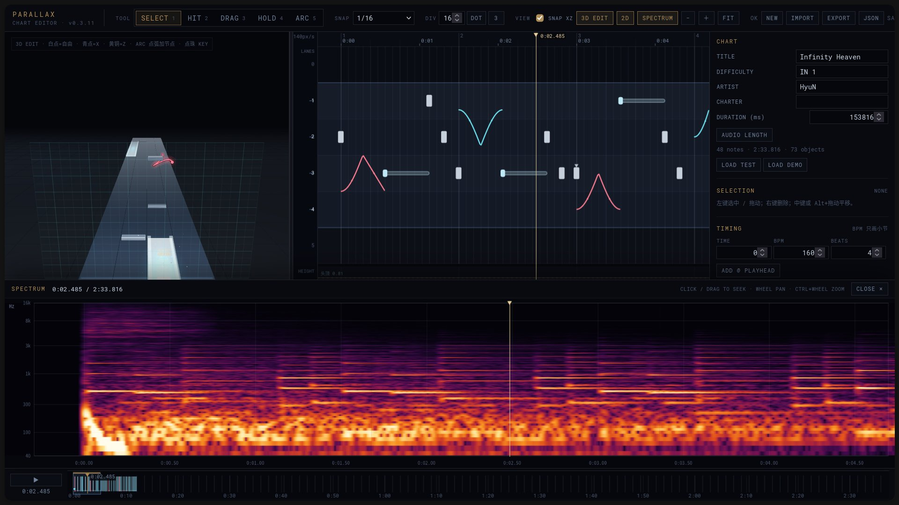
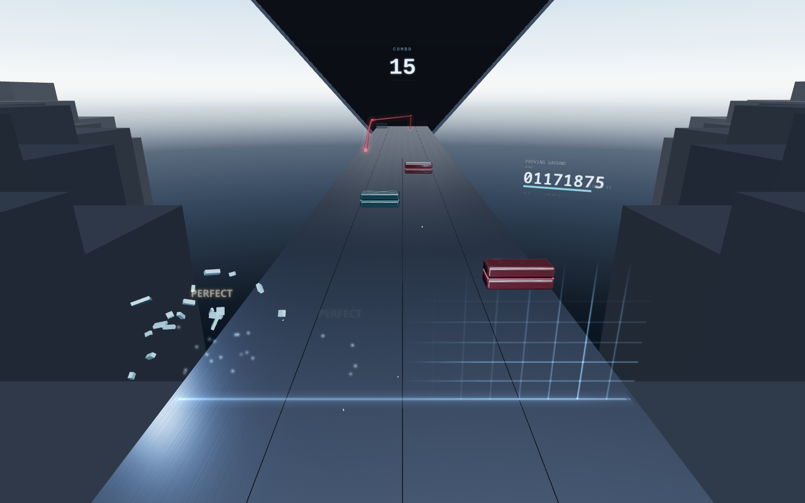

# Parallax

VR 3D 音游的 WebXR 原型。玩家站在腰高的台面前，note 从远处沿 6 条轨道滑来，用手接住；
台面只点亮其中 4 条轨，**窗口会随谱面整体左移 / 右移一轨**（shift）。

> 版本：[`CHANGELOG.md`](CHANGELOG.md) ｜ 未来架构：[`prototype/FUTURE.md`](prototype/FUTURE.md) ｜ 设计真相：[`parallax-idea.md`](parallax-idea.md) ｜ 设计工作流：[`DESIGN-WORKFLOW.md`](DESIGN-WORKFLOW.md) ｜ Phase 1 旧协议：[`agent_old.md`](agent_old.md)（归档） ｜ 迭代记录：[`prototype/STATUS.md`](prototype/STATUS.md) ｜ 谱面格式：[`prototype/CHART.md`](prototype/CHART.md) ｜ 制谱器：[`prototype/EDITOR.md`](prototype/EDITOR.md) ｜ 谱面包：[`prototype/PACKAGE.md`](prototype/PACKAGE.md)

---

## 截图

| 制谱器（v0.3.11） | 游戏（Infinity Heaven 谱面包） |
| --- | --- |
|  |  |

## 状态

**Phase 1 基础 prototyping 已结束（2026-10-19）。**

- WebXR 游戏原型可玩，Quest 3 头显实测 **72Hz+**；
- 桌面制谱器已能完成从导入音频、制谱、频谱定位到导出 `.parallax` 的完整流程；
- 当前版本 **0.3.11**；
- 下一步进入 Unity 时，编辑器的 3D 预览定位、包 / 资源库方案见
  [`prototype/FUTURE.md`](prototype/FUTURE.md)。

---

## 快速使用（v0.3.11）

### 1. 启动

```bash
cd prototype
npm install
npm run dev
```

- 游戏：<http://127.0.0.1:5173>
- 制谱器：<http://127.0.0.1:5173/editor.html>（桌面浏览器，不进 VR）

Quest 3 推荐直接打开 Cloudflare Pages 的固定 HTTPS 地址（部署步骤见
[`prototype/DEPLOY.md`](prototype/DEPLOY.md)）；本地调试仍可用 USB +
`adb reverse tcp:5173 tcp:5173`，然后在头显浏览器打开 `http://127.0.0.1:5173`。

### 2. 写一张谱

1. 打开制谱器，`AUDIO → TRACK` 选本地音频；
   FLAC / MP3 会自动读标题、作者、内嵌封面，并把 `DURATION` 设为音频长度。
2. 用 `HIT / DRAG / HOLD / ARC` 在 2D 主视图或 3D 视图放置 note。
   - 地面键默认吸整轨；空中 hit/drag（z > 0.07m）和 arc 点一样 1/4 轨；
   - `Shift + 点击` 多选 note，拖任意选中项整组移动；
   - `Ctrl / Cmd` 临时关闭时间 / x / z 吸附；
   - 选中 arc 后，3D 白球 = 自由 x/z，青球 = 只改 x，黄铜球 = 只改 z；
     ARC 工具点弧身加节点，点物量珠切 KEY。
3. 在检查器改 `TITLE / ARTIST / DURATION / OFFSET`，没有内嵌封面时在
   `AUDIO → COVER` 手动选图。
4. `EXPORT` 导出 `<title>.parallax`（谱面 + 音轨 + 封面 + 包内资源）。
   `JSON` 只导出旧谱面 JSON，用于调试。

### 3. 玩导出的谱

**最快：不复制文件**

1. 打开游戏页 <http://127.0.0.1:5173/>；
2. 左下角 `LOAD .parallax`，选择刚导出的包，或直接把文件拖进页面；
3. 页面会自动 reload 并开始播放（文件暂存在浏览器 IndexedDB）。

**也可以放到 public**

```bash
cp xxx.parallax prototype/public/packages/
```

并在 `prototype/public/packages/index.json` 里登记；游戏启动时会把索引条目放进 Songs，选中后才懒加载 `.parallax`。

```text
http://127.0.0.1:5173/?pack=/packages/xxx.parallax
```

Quest 3 用同一个 URL；不需要再传文件。

> **`public/packages/` 不是包浏览器。** 放进这个目录不会自动出现在 Songs 列表；
> 当前菜单只显示当前加载的包。要打开包，用 `?pack=` 或页面左下角 `LOAD .parallax`。
> 18MB 的 `infinity-heaven.parallax` 可以用：
> <https://parallax-vr.pages.dev/?pack=/packages/infinity-heaven.parallax>
>
> 本地 `LOAD` 存在 IndexedDB，按 origin 隔离：localhost 加的包不会出现在 Pages 上。

包格式、主题 / 背景预留字段见 [`prototype/PACKAGE.md`](prototype/PACKAGE.md)。

### 4. 包内有什么

```text
chart.json           谱面
audio/<track>        音轨（可选）
cover/<image>        封面（可选）
theme/ background/   提前预留的资源（游戏暂未消费）
```

一个 `.parallax` 就是一张谱的完整发行物；旧的 `?chart=` / `?audio=` 仍兼容。

---

## 进度（2026-10-18）

| Step | 内容 | 状态 |
| --- | --- | --- |
| 0 | Quest 3 打开并进入 WebXR | ✅ |
| 1 | 台面 / 材质 / 光照 / 布局 | ✅ 台面最终是**一层平面** |
| 2 | 四种键型 + 判定 | ✅ |
| 3 | shift（4 轨窗口整体滑动） | ✅ |
| 4 | 谱面播放 / 流速 / 渲染裁剪 / 音频 / UI | ✅ Quest 3 头显实测 **72Hz+** |
| 5 | 简易制谱器 | ✅ **v0.3.11** 独立页面 `/editor.html`；空中 note / x,z、3D arc 编辑、多选、封面 / 时长、单文件 `.parallax`；**已验收** |

已经能完整打一首 41.6 秒的谱（两次 shift、四种键型、SV 变速），有计分、血条、结算、暂停和设置；
也能在桌面制谱器里写谱、导入音频对 offset、用同一个播放器预览并导出单文件 `.parallax`。

---

## 现在能玩到什么

### 台面

- 腰高 **0.95m** 的平面，6 条轨（单轨宽 **0.27m**，进深 10m）；只有窗口内的 4 条会渲染，
  隐藏轨在几何上**真的不存在**（不是被暗板盖住）。
- 0 / 5 进入窗口时比常住的 4 轨暗一档 —— 「没点亮」的状态本身可读。
- 判定带固定贴在台面上（近端内 **0.80m**，比旧版前移 25cm），note 从远处滑过它。

### 四种键型与判定

判定**只看时间**（毫秒），与流速、SV、帧率无关：

| 键型 | 窗口 | 等级 | 动作 |
| --- | --- | --- | --- |
| hit | perfect ±80ms / good ±160ms | PERFECT / GOOD / MISS | 扫过并达到速度 + 位移 |
| drag | ±120ms | PERFECT / MISS | 扫过即可（要一点手速） |
| hold | 每个物量 200–600ms（按密度） | PERFECT / MISS | **按住扳机 / 侧握**贴在片子上 |
| arc | 普通物量 200ms；关键物量（黄铜珠）80ms | PERFECT / MISS | 手沿着弧走 |

坐标是 **x = 横向、z = 高度**（y 是时间，字段是 `time`）。
地面键默认对齐轨中心；离轨要显式写 `x`。hit / drag 可以浮空，**hold 只能贴地**；
arc 的每个点都有 x / z。

drag / arc / hold 没有 GOOD：接上物量就算完美，接不上就是漏。

### 谱面与播放器

- 格式 v0（`prototype/src/chart/`）：`meta` / `timing` / `sections` / `speed`(SV) / `shift` / `notes` / `limits`。
- **位置 = 判定带 − ∫速度 dt**：SV 为 0 时 note 停住、负数时倒流，判定不受影响。
- arc 用点列 + 每段缓动记录形状（linear 是直线 / 直角，sine / cosine 是曲线）；
  物量可以显式写在 `ticks[]` 里，只结算需要接住的时刻，直角可以只划过。
- 默认测试谱 `src/chart/test.ts`：**41.6s / 79 notes**，12s 左 shift、30s 右 shift，两处 SV（慢速 / 200ms 停表）。
- 格式示例 `src/chart/demo.ts`：12s，`?chart=demo` 切回。
- 制谱器导出的 JSON 放到 `prototype/public/charts/`，用 `?chart=/charts/xxx.json` 读取
  （示例：`/charts/example.json`、`/charts/air-example.json`）。

### 音频时钟

- 谱面时间的权威是 **`AudioContext.currentTime`**（含输出延迟补偿），不是逐帧累加的 dt。
- 起播留 **2s lead-in**（谱面时间为负，note 从远处滑进来）；`meta.offset` 是谱面 / 包作者偏移，内部生效但不显示；玩家校准用 Settings 的 `Offset`。
- 没有音频资产：按 `timing` **现场合成鼓组 + 贝斯**（和谱面共用同一张 timing，天然对拍）。
- hit / drag 有打击音（Kenney UI Audio 的 click；hit 更响、drag 更轻），arc 物量 / hold tick 不叠 click。
  想听真曲子：文件放到 `prototype/public/`，用 `?audio=/track.mp3`。
- 暂停 / 恢复会重打锚点，谱面时间不跳。

### 计分 / UI

- 总分 **10,000,000**，按物量等比分配（PERFECT 100% / GOOD 60% / MISS 0），连击只作反馈。
- 血量 100：PERFECT +0.5、GOOD +0.25、MISS −6，归零 = FAILED。
- 浮空显示：曲名 / 作者 / 封面 / 难度 / 物量数 / 分数 / COMBO / 血条，绑定在窗口右缘、跟着 shift 走。
- VR 菜单：Home / Songs / Add packs / Pause / Settings / Result；设置里有流速、音频偏移、音量、节拍器、合成鼓组、起播留白。
  交互是**激光笔（扣扳机）**或直接伸手戳。

### 渲染裁剪

- note 只在判定带前 **9m** 内渲染，最后 4m 渐显；远处不会「凭空出现」。
- 高度上限 **0.81m**（相对台面，= 头顶基准线），超限的 note 不生成。

---

## 制谱器（Step 5）

入口：<http://127.0.0.1:5173/editor.html>（桌面独立页面，不进 VR）。

- **3D 直接编辑**：鼠标在 3D 视图里放下 / 拖走 note（x + z），虚拟网格 + 落点环；
  选中 arc 后是 3D 主工作区：白球自由 x/z、青球只改 x、黄铜球只改 z，ARC 工具点弧身加点，
  新建弧只拖终点（起点钉住），点物量珠直接切 KEY；`SNAP XZ` 可整体关掉，右键拖拽转视角。
- **2D 俯视图**：横轴时间、纵轴 6 轨；地面键默认吸整轨，空中 hit/drag（z > 0.07m）与 arc 点一样 1/4 轨；
  `Shift+点` 多选 note，拖任意选中项整组移动。
- **时间吸附**：常用预设 + `DIV / DOT / 三连` 自定义参数（五连、附点、1/24、1/32 不用翻下拉）。
  `2D` 按钮可关闭，预览 / 2D 之间的分隔条可拖动。
- **高度轨**：hit / drag / arc 的 z（hold 固定贴地）；胸 / 面 / 头顶三条基准线。
- **SV 轨**：点击加变速点、拖动改倍率，检查器改过渡时长 / 缓动。波形在时间轴最底下。
- **底部全局时间线**：Blender 式概览 + scrub + 视口框；2D 隐藏时仍可导航。
- **音频频谱**：`SPECTRUM` 展开；与 2D 视口共用时间范围，指针点击 / 拖动直接定位，收起后 playhead 不变；
  滚轮平移、Ctrl+滚轮缩放。适合找鼓点 / 钢琴 / lead。
- **arc**：点列 + 每段缓动，`linear` 是真正的直线、直角是硬角；`STRAIGHTEN` 一键拉直；
  X / Z 缓动可以分开（`easing` / `easingZ`）；3D 拖动实时重建，不再「松手才动」；
  `ticks[]` 允许只保留需要结算的物量（直角蛇可以拐角不放 tick）。
- **时间吸附**：3 连 / 5 连 / 附点 / 1/32 / 1/24；`Ctrl` 临时自由。
- **预览**：直接跑游戏播放器（音频时钟 + 判定），支持暂停 / 0.25×–2× / 倒放；
  `3D SPEED` 单独调 3D 视图的视觉流速（0.5–10 m/s），不改 SV / 判定 / 音频；
  `AUTO` 现在是到判定线直接 PERFECT，不再模拟移动光点。
- **音频**：导入本地音轨、波形显示、offset ±1/±10 微调；FLAC / MP3 自动读内嵌封面、标题、作者；
  时长默认取音频长度，也可以手改。
- **存取**：`EXPORT` 下载 `<title>.parallax` 单文件谱面包；`JSON` 单独导出；草稿自动存 localStorage；`IMPORT` 两者都读。
- 快捷键和逐项操作见 [`prototype/EDITOR.md`](prototype/EDITOR.md)。

---

## 跑起来

```bash
cd prototype
npm install
npm run dev
```

浏览器打开 <http://127.0.0.1:5173>（桌面 fallback 也能玩：鼠标 = 手，左键 / 空格 = 扳机）。
制谱器是 <http://127.0.0.1:5173/editor.html>。

### Quest 3

WebXR 要求 secure context，所以 **`localhost` / `127.0.0.1` 才行**，局域网 IP 不算。
用 USB + `adb reverse` 把端口映射进去：

```bash
adb devices -l
adb reverse tcp:5173 tcp:5173
cd prototype && npm run dev
```

在头显浏览器里打开 <http://localhost:5173>，点 **ENTER VR**。
不想插线可以把构建部署到 Cloudflare Pages，Quest 直接打开固定 HTTPS 地址；步骤见 [`prototype/DEPLOY.md`](prototype/DEPLOY.md)。
（WSL / 无线 / 隧道的细节见 [`prototype/README.md`](prototype/README.md)。）

## 操作

| 做什么 | 怎么做 |
| --- | --- |
| 开始 | 进 VR 后在主页点 `START`（不再自动开谱） |
| 选歌 / 加包 | 主页 `Songs` 读取 `public/packages/index.json`，包条目在选中后才下载 `.parallax`；`How to add packs` 看 Desktop / Drag / Folder / URL 四种方式 |
| 打键 | 手扫过判定带；hold 要按住扳机 / 侧握 |
| 打 arc | 手跟着弧走；黄铜珠是关键物量 |
| 点 UI | 手柄指向面板扣扳机，或直接戳 |
| 暂停 | 左手柄 **menu** 键，或 **左手 Y 长按 400ms**；桌面按 `Esc` |
| 暂停里的操作 | `RESUME / RESTART / SETTINGS / HOME`；设置是暂停的二级页 |

首次进 VR 落在主页，选 `START` 才开始；打完或血量归零出结算。

## 调试参数（dev）

| 参数 | 作用 |
| --- | --- |
| `?chart=demo` | 切回 12s 示例谱 |
| `?chart=/charts/example.json` | 载入制谱器导出的谱面 |
| `?chart=/charts/air-example.json` | 空中 note + 显式 arc 物量的示例 |
| `?pack=/packages/air-example.parallax` | 自定义谱面包示例（谱面 + 资源，一个文件） |
| 游戏页左下 `LOAD .parallax` | 直接选本地导出的包，不用复制到 public/ |
| `?auto=1` | 自动演示（所有 note / 物量到判定线直接 PERFECT） |
| `?autostart=1` | 跳过主页，直接进游玩 |
| `?warp=12.4&freeze=1` | 快进到第 12.4 秒并冻结（截图 / 检查用） |
| `?flow=4` | 基准流速 m/s |
| `?range=6` | 视距（米，从判定带算） |
| `?panel=home\|songs\|packs\|paused\|settings\|result` | 直接摊开指定面板 |
| `?chrome=0` | 隐藏诊断 / lil-gui / Stats / 包加载器，给面板截图留干净背景 |
| `?lane=0.27` `?band=0.80` | 调轨宽 / 判定带前移距离（米；生产页也可用） |
| `?panelScale=1.05` `?panelDistance=0.65` `?panelY=1.45` | 调 VR 面板尺寸 / 距离 / 高度（生产也可用） |
| `?vr=1` | 假装在 VR 里（检查 `EXIT VR` 等只在头显出现的元素） |
| `?menuButton=6` | 改 menu 键的 gamepad 索引（默认 6；读不到时用左手 Y 长按） |
| `?clock=0` | 关掉音频时钟（无头截图用） |
| `?offset=20` `?volume=0.6` `?lead=2000` `?metronome=1` `?audio=/track.mp3` | 音频 |
| `?maxheight=0.5` | 临时压低高度上限，验证「超限不生成」 |
| `?shift=left` `?cam=` `?look=` `?exposure=` `?env=` | 场景调试 |

## 仓库结构

```
parallax-idea.md     设计真相（判定、键型、shift、配色、材质隐喻）
DESIGN-WORKFLOW.md   设计实验环境的使用边界（先做夹具，再回主代码）
agent_old.md         Phase 1 旧施工协议（已归档，不再遵循）
references/          空间 / 材质参考
resources/           作者源素材（谱面 / 音频 / 主题 / 背景；运行时不用）
design/ui-2d/        2D UI study（A + C 的排版 / 配色 / 密度试验）
prototype/
  src/
    chart/           谱面格式、时间轴（SV 积分 / shift / 小节）、示例谱、验收谱
    game/            播放器、判定、计分、arc、hold/drag、手、粒子、弹字
    audio/           音频时钟、程序化节拍轨
    pack/            .parallax 自定义谱面包：容器格式 + 浏览器读取
    scene/           台面、浮空显示、材质实验台、控制器
    materials/       材质库、配色、程序化贴图、视距淡出
    ui/              3D 面板、游戏内 UI、调试面板、诊断
    editor/          制谱器（时间轴 / 交互 / 预览 / 检查器 / 波形 / 存取）
  editor.html        制谱器独立入口
  public/charts/     旧格式谱面（example.json / air-example.json）
  public/packages/   .parallax 谱面包（air-example.parallax）
  PACKAGE.md         .parallax 包格式与资源约定
  CHART.md           谱面格式说明
  EDITOR.md          制谱器操作与设计说明
  STATUS.md          迭代记录（每轮改了什么、为什么、踩了什么坑）
  README.md          原型自己的运行 / 链路说明
```

## 已知问题

- **音频**：调度路径验过（`playing · 16–24ms`），但「听感对不对」需要戴上去确认；
  偏早 / 偏晚用设置里的 `AUDIO OFFSET` 微调。
- 暂停时长按扳机再松手，可能顺带触发一次 UI 点击（面板和判定共用「按下」）。
- 制谱器：音频 / 封面文件不持久化到草稿，但会进 `.parallax` 包；多选只覆盖 note；没有框选 / 复制粘贴 / 自动 BPM 检测；
  慢放和倒放是静音的（AudioContext 不能倒退）；3D 里 arc 点的时间仍要在 2D / 检查器改；
  没音轨时默认不播合成鼓点（走带 `DRUMS` 勾选才响）。
- hold 只能贴地；hit / drag 可以浮空（设计文档同步为这个规则）。

## 下一步

Phase 1 已验收。后续按 [`prototype/FUTURE.md`](prototype/FUTURE.md) 推进 Unity /
资源库：先抽玩法契约和 golden tests，再做 Unity importer、工作区与共享资源索引。

游玩端 VR UI 的入口流程、暂停层级、激光误触与视觉方向记录在
[`prototype/UI-BACKLOG.md`](prototype/UI-BACKLOG.md)；P0–P2 已实现，待 Quest 3 验收。
做新的视觉 / 版式实验前，先读 [`DESIGN-WORKFLOW.md`](DESIGN-WORKFLOW.md)。
