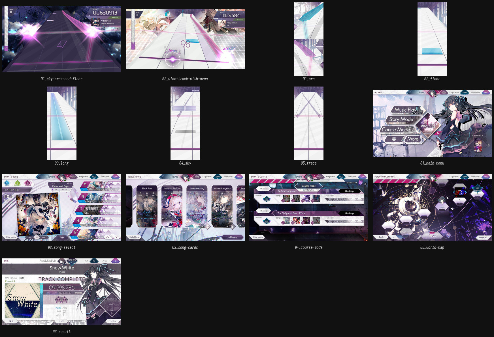

# Arcaea — 4 轨的 2.5D 先例

## 为什么先拆它

Arcaea 的官方描述只有一句，但正好命中 Parallax：

> **Track**: The scrolling plane comprising the **4 lanes**.
> **Floor Input**: the solid purple horizontal line near the bottom.
> **Sky Input**: the striped horizontal line cutting across the middle.

同样是 4 轨可视窗口（Parallax 物理场 6 轨、默认显示 4 轨），同样有「地面」和「天空」两个输入面，同样用蓝 / 红区分左右手。
它是目前最接近 Parallax 布局的现成答案——**但它是 2.5D，Parallax 是真 3D**。

## 最重要的一条：Arcaea 把高度折叠成了纵深

| | Arcaea | Parallax |
| --- | --- | --- |
| 地面 | Floor Input，屏幕下方（**近**） | 腰高，真实高度 |
| 天空 | Sky Input，屏幕中部（**远**） | 头顶以上，真实高度 |
| 读法 | 透视收敛 + 屏幕边界 | 俯视 + 槽的侧壁 + 遮挡 |

所以：**不能直接把 Arcaea 的透视搬进头显。**
在 Arcaea 里，「天空」= 远；在 Parallax 里，「天空」= 高。这两件事在屏幕上看起来相似，在 VR 里是垂直与水平的区别。
能搬的是「两个输入面界定一个可打区间」这个概念，不是它的画面。

## 逐图

### 游玩画面（2 张）

| 图 | 画面里能直接看到 | 可迁移 | 别抄 |
| --- | --- | --- | --- |
| [01_sky-arcs-and-floor.jpg](arcaea/gameplay/01_sky-arcs-and-floor.jpg) | 深色曲目。两条品红 Arc 从左右两侧掠过天空区；地面 4 条纵向分轨线收敛到远端；右上角是分数/曲名/难度面板；左侧竖条是 Recollection 槽 | 双输入面同框；Arc 的前缘最亮、条身半透明；纵向分轨靠细线 + 远端收敛 | 背景星空与碎片亮度太高，轨道是靠「比背景更暗」才读出来的；Parallax 的浅色台面没有这层退路 |
| [02_wide-track-with-arcs.jpg](arcaea/gameplay/02_wide-track-with-arcs.jpg) | 浅色曲目（白雪）。近白轨道、青色 Arc、紫色 Trace、白色 Floor Input 线横贯；地面键几乎融进轨道 | Arc 在浅色底上靠**饱和度**而不是亮度区分；Track 表面有横向阶差，提供纵深节奏 | 浅色模式的地面键对比不足——这正是 4.6 说的缺口，Arcaea 自己也没完全解决。可直接当反例 |

### 键型近景（5 张，300×750，仅看形状比例，不看材质细节）

| 图 | 画面 | 可迁移 |
| --- | --- | --- |
| [01_arc.jpg](arcaea/note-types/01_arc.jpg) | 青/紫两条 Arc 在天空输入线附近交叉。条身半透明，**两端有宽大的平切端面**，边缘有一条亮边 | Arc 不是一条发光线，而是一条**有厚度、有端面**的挤出面。端面就是 4.3 说的「正面」，它让 ribbon 在 3D 里不塌成纸片 |
| [02_floor.jpg](arcaea/note-types/02_floor.jpg) | 浅蓝地面键贴在轨面上，底部是白色 Floor Input 线 | 地面键必须与轨面有接触阴影/边缘，否则会浮起来 |
| [03_long.jpg](arcaea/note-types/03_long.jpg) | 青色 Hold 长条，端头更亮，条身有渐变，压在轨面上 | Hold 用「端头 vs 条身」的亮度差表达进度；不是整条均匀发光 |
| [04_sky.jpg](arcaea/note-types/04_sky.jpg) | 空中键是一根**倒角长条**，横跨在很远的轨道上方，一条 Trace 从它中间穿过 | 空中键用挤出的棱柱而不是贴片；倒角高光让它在远景里仍有一个面 |
| [05_trace.jpg](arcaea/note-types/05_trace.jpg) | 两条 Trace 交叉成 X，末端落在 Floor Input 上，端头有箭头状收口 | Trace 不是键，所以可以细、可以暗；这给 Parallax 一个提示：**「引导」和「可打」必须用两种厚度说话** |

### 界面（6 张）

| 图 | 画面 | 可迁移 | 别抄 |
| --- | --- | --- | --- |
| [01_main-menu.jpg](arcaea/ui/01_main-menu.jpg) | 左侧四条斜切平行四边形菜单条（Music Play / Story Mode / Course Mode / More），中央菱形 World，右侧角色立绘，顶部状态带 | 菜单项是**条带**而不是按钮；斜切角给静态界面一个方向；信息靠条带的堆叠与错位分组 | 立绘占掉一半画面。VR 里没有「背景插画」这一层 |
| [02_song-select.jpg](arcaea/ui/02_song-select.jpg) | 左：大封面 + 曲名/BPM；右：斜切歌曲列表，每行左侧是难度菱形（蓝/绿/紫/红），顶部难度筛选 | 难度用「形状 + 颜色 + 数字」三重编码；选中行拉开距离，未选中行压暗 | 列表密度对触屏刚好，对头显偏密；VR 里一屏最多 3–4 行 |
| [03_song-cards.jpg](arcaea/ui/03_song-cards.jpg) | 横向卡片轮播，卡片顶部斜切，底部是难度圆点 | 卡片可以「立」在空间里，像一排铭牌 | 纯平面卡片在 3D 里会变成一排纸 |
| [04_course-mode.jpg](arcaea/ui/04_course-mode.jpg) | 阶段列表，条带 + 阶段标签 + 歌曲缩略图 | 用「条带包含条带」表达层级，不用缩进 | 装饰性紫色渐变太多，和键的颜色抢注意力 |
| [05_world-map.jpg](arcaea/ui/05_world-map.jpg) | 六边形节点地图，中央是圆形机械装置 | 圆形/六边形节点可以作为「世界」的空间隐喻；中心装置有明确的「可进入」感 | 装饰密度过高。Parallax 的仪器语言里，六边形要换成可辨认的铣削/装配结构 |
| [06_result.jpg](arcaea/ui/06_result.jpg) | TRACK COMPLETE：一个大分数、AA 评级、PURE/FAR/LOST 三行统计、曲绘背景 | 结算的信息层级极干净：**1 个主数字 + 1 个评级 + 3 个统计**，其余都退后 | 曲绘背景在 VR 里会变成一面发光的墙 |

## 拆解

### 1. 4 轨窗口的读法：线 + 收敛，但没有「槽」

Arcaea 用三条纵向细线把轨道等分成 4 份，再靠透视把它们收向远端。近处的轨宽、远处的轨窄，玩家靠这个梯度判断左右。

这在 2D 里够用，因为它只有「左右」一个自由度需要读。
Parallax 多了两个自由度：**高度**（腰 → 头顶）和**整体横移**（shift）。线不再够用：

- 高度要靠**槽的深度**和**侧壁遮挡**来读；
- shift 要靠一个**不动的外部参照**来读——固定外框、刻度或身体位置都可以；具体用哪一种还没验证。

参考图在这里的任务不是给答案，而是证明：**只要 4 轨窗口的槽壁足够实体，玩家不需要额外的 UI 就能数清轨数。**

> **2026-10-26 作废**：Parallax 最终没有走槽壁。腰高 4 轨可读性已在 Quest 3 验收通过——
> 细分割线 + 0 / 5 暗一档 + 窗口随 shift 整体滑动就够；台面不挖槽、键浮在台面上。
> 这句只保留为参考分析的历史结论。

### 2. Arc 的可读性：状态机比形状更重要

Arcaea 的 Arc 有一套完整的状态，值得逐条对照 4.2：

| Arcaea 的行为 | Parallax 的对应 |
| --- | --- |
| 手指漂移 → Arc 变半透明 | 玻璃管内出现真空段 / 光团变暗 |
| 短暂宽限内回到线上 → 不扣 | 快速重连只回退一小段（4.2 已写） |
| 松手 / 换手 / 换色 → Arc 变红 → LOST | 管壁留下疤痕；断连 = 损失物量，按比例扣总分（没有额外连击分） |
| 握持左/右 Arc → 整个轨道轻微倾斜（左逆时针、右顺时针） | **不能常驻**。全局倾斜在 VR 里是晕动源；只能进愚人节 / 搞笑谱面 |

最后一条尤其重要：Arcaea 可以用整个轨道的倾斜来回应你的手，因为屏幕不会晕。
Parallax 的反馈必须**局部化**——反馈发生在管子里，不能发生在世界上。

### 3. Hold 的宽容度：Arcaea 已经做了，Parallax 只是加了一个变量

Arcaea 的 Long Note：可以中途接回；松手有短暂 grace period；接回时可能先掉几个 LOST。
这和 4.2 的 hold 设计几乎一致。Parallax 的增量是**容忍度随密度变化**——这条没有参考，需要自己调曲线。

### 4. HUD：只有分数是大字

Arcaea 的游玩 HUD 信息量其实不小（分数、进度、曲名、封面、难度、FR/PM 点、gauge），但它把**除分数以外的所有东西都压到很小**，并且全部贴在角落。
Parallax 的 HUD 托架可以沿用这个层级：**一个主数字 + 一圈状态点**，其余进「托架」的边缘。

### 5. 菜单：条带是它的核心语法

斜切平行四边形、菱形、六边形——这些形状在 Arcaea 里不是装饰，是**分组工具**：
一条斜带 = 一个可选项；一条更长更粗的带 = 一个层级；菱形 = 一个难度；六边形 = 一个世界节点。

这套语法可以直接翻译成 Parallax 的机加工面板：

- 斜切条带 → 面板上铣出的**长槽**，槽底刻字；
- 菱形难度 → 面板上的**硬度标记/刻痕**；
- 六边形节点 → **装配孔位**或**导轨滑块**。

翻译的是「用实体形状分组」，不是「用六边形装饰」。

## 借 / 不借

**借**

- 双输入面界定可打区间的概念（下界/上界）。
- 4 轨窗口的「等分 + 收敛」读法（2026-10-26：不做实体槽壁；细分割线 + 0/5 暗一档已验收）。
- Arc 的宽限状态机：漂移 → 半透明 → 宽限 → 断连留痕。
- Hold 的中途接回 + grace period。
- 颜色 = 左右手（青/赤釉），但必须加冗余线索。
- 结算的 1 + 1 + 3 信息层级。
- 条带式菜单分组。

**不借**

- 2.5D 的纵深折叠（天空 = 远）。
- 星空/碎片/曲绘背景（对比度竞争者）。
- 晶体碎屑、发光描边、二次元立绘。
- 全局轨道倾斜作为常驻反馈。
- 六边形装饰密度。

## 对 Parallax 的三个直接结论

1. **4 轨窗口不是问题，6 轨场 + 高度 + shift 才是问题。** Arcaea 只解决了 4 轨窗口的读法，后两个是空白。
2. **Arc 的「体积」已经被 Arcaea 证明是必要的**：它给 ribbon 加了端面和厚度，所以不塌。这直接支持 4.3，也反证了 v0 的细线方案。
3. **浅色模式的对比问题，Arcaea 也没解决。** 不要指望「换一套 tint」能过关；4.6 说的边缘/描边 pass 是必须的。
