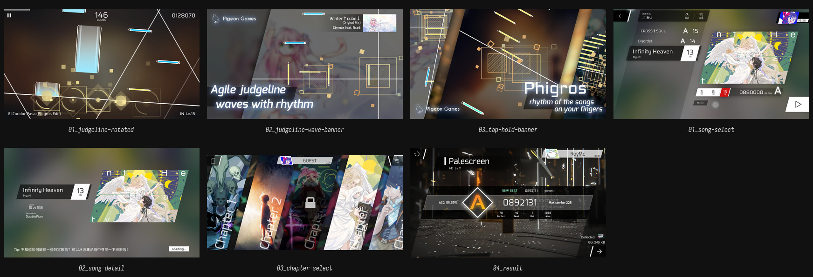

# Phigros — 判定线作为唯一的「活动参照」

## 为什么是第二参考

Phigros 和 Parallax 的关系不在布局，在**规则**：

- 它的判定线会旋转、倾斜、波动、增删；
- 键可以移动、旋转、加速、凭空出现；
- 键自己可以当判定线，屏幕边缘也可以当判定线。

这正是文档里 **CYCLOTRON「打破规则」** 想做的事。Phigros 是这个方向最成熟的现成案例，也是最清楚的反面教材——因为它能成立的前提，在 VR 里并不成立；而且 Parallax 的判定线常态不动。

## 最重要的一条：判定线能动，是因为它是画面里唯一的高对比物

Phigros 的游玩背景是**虚化的曲绘**，整体压暗、低对比；判定线是纯白，键是白边 + 高饱和填充。
所以无论线怎么转，眼睛永远能先找到线。

Parallax 的画面里同时有：金属高光、玻璃内光、釉面反光、接触阴影。**判定线一旦也变成一根发光的线，就会和材质抢对比。**
所以不能照搬「白线」，只能照搬它的**地位**：判定面必须是整个槽里对比最高、状态最明确的那一层。具体做法应该是「槽底的一段亮带」——材质状态，不是几何体。

> **Parallax 的硬性分界**：判定线是结构的一部分，常态下相对槽底不动。Phigros 的「线动」只作为愚人节 / 搞笑谱面的参考，不能进常规谱面；CYCLOTRON 也不例外（见 `parallax-idea.md` 5.1）。

## 逐图

### 游玩画面（3 张）

| 图 | 画面里能直接看到 | 可迁移 | 别抄 |
| --- | --- | --- | --- |
| [01_judgeline-rotated.jpg](phigros/gameplay/01_judgeline-rotated.jpg) | 两条白色判定线交叉成 X；金色方框+圆心的是**高亮的同时按键**（普通 tap 是天蓝）；青色长条是 Hold；右侧细黄条是 Drag；上方 Combo 146 | 判定线可以整体倾斜而不影响读谱；键型靠「方框 / 长条 / 细条」三种轮廓区分，不靠图标 | 背景是虚化曲绘 + 暗角，在 VR 里会变成一层有深度的发光墙 |
| [02_judgeline-wave-banner.jpg](phigros/gameplay/02_judgeline-wave-banner.jpg) | 判定线呈波浪；官方宣传语 "Agile judgement line waves with rhythm"；可见 Hold、Tap、Drag | 线本身可以被编排成演出；键始终「长」在线上 | 文字压在图上是商店图的做法，不是 UI |
| [03_tap-hold-banner.jpg](phigros/gameplay/03_tap-hold-banner.jpg) | 判定线斜置；黄色 Drag 成排；青色 Hold；金色高亮 Tap；宣传语 | 斜置时键仍然贴着线走——**键和线是同一个坐标系**，这是不失读的关键 | 同上 |

### 界面（4 张）

| 图 | 画面 | 可迁移 | 别抄 |
| --- | --- | --- | --- |
| [01_song-select.jpg](phigros/ui/01_song-select.jpg) | 左侧深色列表 + 分数；选中行是白色块（Infinity Heaven / 13 IN）；右侧是斜切的曲绘；难度页签 EZ 白 / HD 黄 / IN 红 | 选中行用**反白整块**而不是描边；难度用三种纯色块，一眼可辨 | 一块白色整行在 VR 里太亮，会压过键 |
| [02_song-detail.jpg](phigros/ui/02_song-detail.jpg) | 左：曲名/作者/谱师/画师；右：斜切曲绘；底部提示与 Loading | 曲绘是**斜切平行四边形**，不是矩形——一个变形就让平面有了方向 | 信息块全是平面文字，进 VR 会像网页 |
| [03_chapter-select.jpg](phigros/ui/03_chapter-select.jpg) | 5 张斜切章节卡并排，每张用曲绘代表章节，编号压在卡上 | 用「一排立起来的卡」表达章节；卡与卡之间留缝，靠缝读顺序 | 卡面信息量太低，全靠插画；Parallax 没有这么多插画预算 |
| [04_result.jpg](phigros/ui/04_result.jpg) | 结算：大字母评级 A、分数、ACC、Max Combo、Perfect/Good/Bad/Miss、Collected 碎片 | 评级字母是唯一的大形状，数字退后；统计数据用 2×2 网格 | 背景曲绘抢眼，结算的焦点应该是数字不是图 |

## 拆解

### 1. 判定线 = 坐标系，不是装饰

Phigros 的键不是「在屏幕坐标里飞向一条固定的线」，而是**在判定线的局部坐标里运动**。线转了，键跟着转，所以玩家不需要重新学习键的朝向。
这是它敢让线乱动的根本原因。

Parallax 的等价物：**判定带永远贴在槽底**。槽可以倾斜（仅愚人节 / 搞笑谱面），但判定带与槽底的相对关系不变。
如果判定带浮在槽上方，槽一动，带和键就会脱节——这是必须避免的。

### 2. 键型靠轮廓，不靠颜色

| 键型 | Phigros 的轮廓 | Parallax 的材质 |
| --- | --- | --- |
| Tap | 方框 + 内圆 | 陶瓷（hit） |
| Hold | 长条 | 光滑玻璃管 |
| Drag | 短黄条（个体） | 冰锥 |
| Flick | 红色箭头状 | 暂无对应（Parallax 没有 flick） |

> 这里的材质都是「像」，不是写实模型；见 `parallax-idea.md` 4.2。

Phigros 的颜色也在编码（天蓝/黄/红），但即使去掉颜色，三种轮廓仍然可分。
Parallax 的材质语言更强（陶瓷 / 冰锥 / 光滑玻璃管），但要小心：**材质差异在低光/远距离下会先消失**。必须像 Phigros 一样，让轮廓也能独立成立。

### 3. 判定是一个「柱」，不是一个「点」

Phigros 的判定规则：只要在「从键延伸到屏幕边缘的竖直列」内击中，就算有效。
这是一个非常宽的 2D 容错，它让高速谱面不至于变成像素级操作。

VR 的对应物是**一个从键延伸出来的 3D 判定体**：
- 对 `hit`：一个短而粗的柱，要求速度和方向，但不要求毫米级位置；
- 对 `drag`：每个冰锥周围一个小判定体，要求手速；
- 对 `arc`：一条管状的跟随区，要求手在管内。

这套「判定体」的形状，比判定线的形状更重要。参考图只能提示方向，具体尺寸要自己调。

### 4. CYCLOTRON 的现成清单

Phigros 已经做过、**只能作为愚人节 / 搞笑谱面素材**的：

- 判定线旋转 / 倾斜 / 波浪；
- 多条判定线同时存在；
- 键在判定线之间跳跃；
- 键自己充当判定线；
- 屏幕边缘充当判定线；
- 键隐形 / 瞬移（极端案例）。

Parallax 的硬限制见 `parallax-idea.md` 5.1：**常规谱面判定线相对槽底不动。** 下面这些不能直接搬，只能作为愚人节 / 搞笑谱面素材：

| Phigros | Parallax 的翻译（仅愚人节 / 搞笑谱面） |
| --- | --- |
| 判定线旋转 | 槽底亮带偏移 / 倾斜，槽体不动 |
| 多条判定线 | 多个槽同时进入判定状态；常规是单槽单带 |
| 键当判定线 | 一条 Arc 成为相邻轨的判定参照 |
| 屏幕边缘当判定线 | 不成立。VR 没有屏幕边缘，只有世界边界 |

## 借 / 不借

**借**

- 判定线是「坐标系」而不是「一根线」的思路。
- 键型用轮廓做第一编码、颜色做第二编码。
- 「判定柱」的宽容错概念。
- 斜切/倾斜的卡片排版（UI）。
- 难度用纯色块 + 数字双编码。
- CYCLOTRON 的异象清单（仅愚人节 / 搞笑谱面；不得动判定线、不得加障碍物）。

**不借**

- 平面虚化的曲绘背景（作为贴片会深度冲突；可以换成真 3D 舞台）。
- 纯白高亮判定线（和材质抢对比）。
- 平面文字块直接进 3D。
- 反白整行的选中态（太亮）。
- 把「线动」当成默认演出——Parallax 的默认状态必须是静的。
- 判定线独立运动、障碍物 / Noise Field。

## 对 Parallax 的直接结论

1. **判定面要降级成材质状态**：槽底被照亮的一段带，而不是浮线。
2. **键型先靠轮廓、再靠材质**：远距离/低光下材质会先丢失。
3. **常规谱面判定带不动；愚人节 / 搞笑谱面才允许偏移**：Phigros 的自由度只作为愚人节 / 搞笑谱面的素材，不能进常规谱面。
4. **同时按键需要冗余提示**：Phigros 用「高亮变黄」提示和弦；Parallax 的 4 轨窗口和弦也需要一个不依赖颜色的提示（例如槽底同时亮起）。
