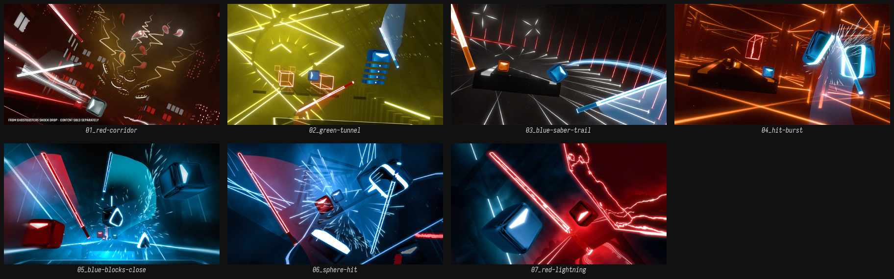
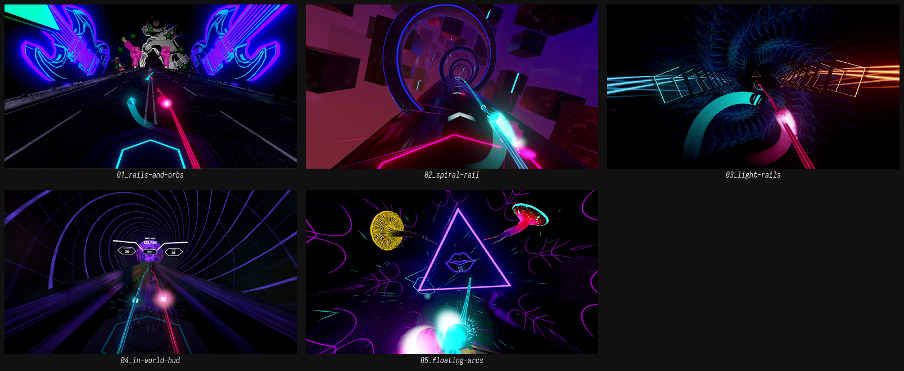
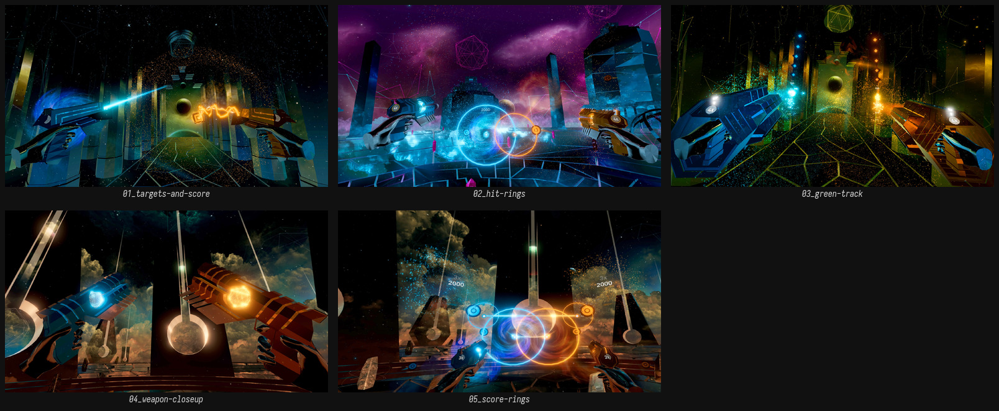
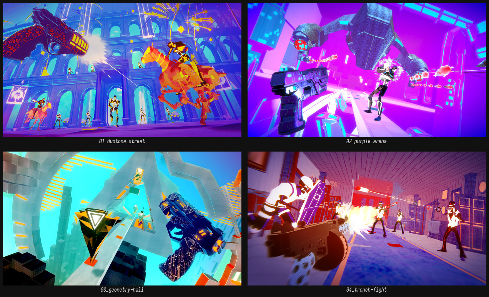

# VR 音游 — 空间语法，而不是表面风格

这四款都不是 Parallax 的同类（没有 4 轨窗口 / 6 轨场、没有腰高、没有 shift），但它们回答了同一个问题：

> **在一个没有屏幕的空间里，怎么让玩家知道「什么时候、打哪里、用哪只手」？**

答案不是 UI，是**空间本身**。这也是 Parallax 最需要补的一课。

## Beat Saber — 没有轨道，也能读出位置

| 图 | 画面 | 观察 |
| --- | --- | --- |
| [01_red-corridor.jpg](vr-rhythm/beat-saber/01_red-corridor.jpg) | 红黑走廊，双剑交叉，方块与碎片飞散 | 方块**永远正面朝向玩家**；颜色 = 手（红/蓝）；面上箭头 = 切割方向 |
| [02_green-tunnel.jpg](vr-rhythm/beat-saber/02_green-tunnel.jpg) | 黄绿隧道，一个蓝色带箭头方块 | 单个方块也能读，因为「朝向 + 箭头 + 颜色」三件事同时成立 |
| [03_blue-saber-trail.jpg](vr-rhythm/beat-saber/03_blue-saber-trail.jpg) | 蓝剑轨迹划过红黑场景 | 剑的拖尾是**唯一**的运动线索；没有准星、没有轨道线 |
| [04_hit-burst.jpg](vr-rhythm/beat-saber/04_hit-burst.jpg) | 橙红场景，白色斩击爆点 | 命中反馈是「白闪 + 碎片 + 音效」，不靠 UI 数字 |
| [05_blue-blocks-close.jpg](vr-rhythm/beat-saber/05_blue-blocks-close.jpg) | 两个蓝色方块近距离，白色碎屑 | 方块有厚度、倒角、接触阴影；不是贴片 |
| [06_sphere-hit.jpg](vr-rhythm/beat-saber/06_sphere-hit.jpg) | 蓝色球体炸成碎片 | 爆炸的碎片**继承**了被击物的颜色与材质 |
| [07_red-lightning.jpg](vr-rhythm/beat-saber/07_red-lightning.jpg) | 红色闪电缠绕方块 | 背景可以很花，因为可打物的**明度**始终高于背景 |

**可迁移**

- 颜色 = 手，这一条在 VR 里几乎是免费的。Parallax 的青釉/赤釉是同一逻辑的材质化。
- 方块正面朝向玩家，是 3D 里最强的可读性技巧。
- 命中反馈不需要 HUD：粒子 + 音效 + 手部震动就够。

**不可迁移**

- Beat Saber 的方块**大、少、间距宽**。Parallax 的 4 轨可视窗口（物理场 6 轨）在腰高，键更小更密，不能只靠隐式网格；必须有实体槽做参照。
- 它的背景是纯暗色，没有材质竞争。Parallax 的金属台面本身就是高光来源。
- 墙 / 炸弹 / 需要躲避的物体——Parallax 的可打区没有障碍物（见 idea 5.2）。

## Synth Riders — 最接近 Arc 的 VR 实现

| 图 | 画面 | 观察 |
| --- | --- | --- |
| [01_rails-and-orbs.jpg](vr-rhythm/synth-riders/01_rails-and-orbs.jpg) | 霓虹舞厅，地面青/品红两条轨道，中央一个光球，前景多边形环 | Rail 是**贴地的发光管**，不是线；手要沿着它走 |
| [02_spiral-rail.jpg](vr-rhythm/synth-riders/02_spiral-rail.jpg) | 紫色星域隧道，轨道向中心收敛 | 隧道把「前方」变成一个明确的目标；视线被引导 |
| [03_light-rails.jpg](vr-rhythm/synth-riders/03_light-rails.jpg) | 粉蓝空间，尽头有螺旋环，青/品红双轨 | 双轨 = 双手，和 Arcaea 的青/粉是同一套编码 |
| [04_in-world-hud.jpg](vr-rhythm/synth-riders/04_in-world-hud.jpg) | 同心圆隧道，中央悬浮 HUD 面板（COMBO 等） | HUD 在**世界里**，不在屏幕上；它跟着轨道走 |
| [05_floating-arcs.jpg](vr-rhythm/synth-riders/05_floating-arcs.jpg) | 暗紫空间，漂浮的三角/圆环轮廓，品红描边 | 背景轮廓用**低亮度、细线**，不抢轨道 |

**可迁移**

- Rail = Arc 的 VR 版：手跟随，不需要「击中」。
- 双色双轨的编码方式，和 Parallax 的左右手完全一致。
- HUD 可以在世界里（轨道尽头/上方），不必贴在视野边缘。

**警示**

- Rail 太细、太亮时，遇到复杂背景会**丢**（01 和 05 都能看出这个问题：背景的霓虹手/轮廓和 rail 抢注意力）。
- Parallax 的玻璃管必须有**外壁轮廓 + 内部光带 + 接触阴影**三件套，才能在金属台面上不丢。这正好回到 4.3。

## AUDICA — 目标正面性与世界内计分

| 图 | 画面 | 观察 |
| --- | --- | --- |
| [01_targets-and-score.jpg](vr-rhythm/audica/01_targets-and-score.jpg) | 蓝/橙双枪在画面下方，远处靶标，分数 1743 浮在空中 | 分数是**世界里的数字**，不是 HUD |
| [02_hit-rings.jpg](vr-rhythm/audica/02_hit-rings.jpg) | 蓝/橙光柱之间，靶标被白色命中环包围 | 命中环向外扩张，是「时间」的可视化 |
| [03_green-track.jpg](vr-rhythm/audica/03_green-track.jpg) | 绿色轨道 + 橙色靶标 | 轨道有明确的边界和纵深，靶标沿轨道排布 |
| [04_weapon-closeup.jpg](vr-rhythm/audica/04_weapon-closeup.jpg) | 蓝/橙双枪特写，枪口光 | 左右手 = 蓝/橙，和 Beat Saber 同构 |
| [05_score-rings.jpg](vr-rhythm/audica/05_score-rings.jpg) | 蓝/橙同心环，分数 2000 浮空 | 计分元素本身就是场景装饰 |

**可迁移**

- 靶标**正面朝向玩家**，并用同心环表达「距离/时机」。
- 双手颜色编码 + 枪口朝向，让「用哪只手」不需要文字。
- 计分可以成为场景的一部分，而不是一块屏。

**风险**

- AUDICA 的靶标是「射击」目标，不需要手的速度/力度；Parallax 的 hit 需要。AUDICA 的反馈（命中环）不能直接回答「用力」这件事。

## Pistol Whip — 抽象但不失体积

| 图 | 画面 | 观察 |
| --- | --- | --- |
| [01_duotone-street.jpg](vr-rhythm/pistol-whip/01_duotone-street.jpg) | 蓝/橙双色调西部街景，低多边形马与敌人 | 低多边形仍然有**面、影、剪影**；没有纹理噪点 |
| [02_purple-arena.jpg](vr-rhythm/pistol-whip/02_purple-arena.jpg) | 品红竞技场，巨大雕像与敌人 | 敌人用高饱和色从背景里跳出来 |
| [03_geometry-hall.jpg](vr-rhythm/pistol-whip/03_geometry-hall.jpg) | 青/橙几何大厅，巨大的字母积木 | 抽象几何也有厚度和投影；不是线框 |
| [04_trench-fight.jpg](vr-rhythm/pistol-whip/04_trench-fight.jpg) | 紫红战壕，枪口闪光 | 枪口闪光是唯一的高亮，焦点明确 |

**可迁移**

- **抽象 ≠ 去掉质量**：Pistol Whip 把装饰降到零，但每个物体都有体积、投影和明确的明度分层。这是对 v0 失败最直接的反证。
- 双色调 + 高饱和焦点，比「全材质写实」更容易读。

**不可迁移**

- 它的低多边形风格是刻意的「玩具感」，和「精密仪器」相反。借的是**明度分层法**，不是造型。

## 四款放在一起，能确认的三件事

### 1. HUD 只有两种活法

| 做法 | 例子 | 代价 |
| --- | --- | --- |
| 几乎没有 HUD | Beat Saber | 玩家不知道分数，但完全沉浸 |
| HUD 是世界里的物体 | AUDICA 的浮空分数、Synth Riders 的中央面板 | 需要为它设计一个「位置」，而且会挡视线 |

Parallax 的「HUD 托架」属于第二种。要先决定：托架固定在**世界**（转头会离开）还是**视野**（永远在边缘）。
前者更仪器，后者更安全。目前文档没有决定。

### 2. 背景是舞台，也是对比度竞争者

四款游戏的背景都在做同一件事：**把非可打层的明度压下去，把可打物提上来**。
Beat Saber 用纯暗；Synth Riders 用低亮轮廓；AUDICA 用暗色星空；Pistol Whip 用双色调压缩。

但「压暗」不等于「不能动」。背景可以是 3D 舞台、可以动画、可以用 shader——Synth Riders 和 AUDICA 的隧道就是现成例子。它们的共同点不是「暗」，而是**在可打层之外**，且明度低于可打物。

Parallax 的金属台面天然是高光来源，这是它和所有参考最大的不同。
所以 4.2 的「金属永不为键」不只是语义规则，也是**对比度规则**：金属一旦进入可打物的明度区间，轨道就会开始「长键」。背景也一样：它可以亮、可以动，但不能亮过键、不能进入可打区。

### 3. 反馈必须局部化

Beat Saber 的反馈发生在方块上；AUDICA 的反馈发生在靶标上；Synth Riders 的反馈发生在轨道上。
没有一款游戏用「世界跟着手倾斜」做常规反馈——因为会晕。

Arcaea 可以倾斜整个轨道（见 `01-arcaea.md`），Parallax 不可以。这是 VR 与平面音游最硬的一条分界。

## 仍然没有答案的

- 腰高 4 轨窗口 / 6 轨场的构图（所有参考都是「前方」或「地面」，没有「低头看腰」）。
- 头顶空域的上界怎么被看见（没有屏幕边缘可以画线）。
- 整体横移（shift）的参照物（没有任何参考有等价机制）。
- 金属 + 陶瓷 + 冰 + 玻璃在头显里的表面行为（这批图全是霓虹/低多边形）。
- 3D 背景演出的预算：明度、深度、运动速度、shader 复杂度，如何在不抢键的前提下成立。
