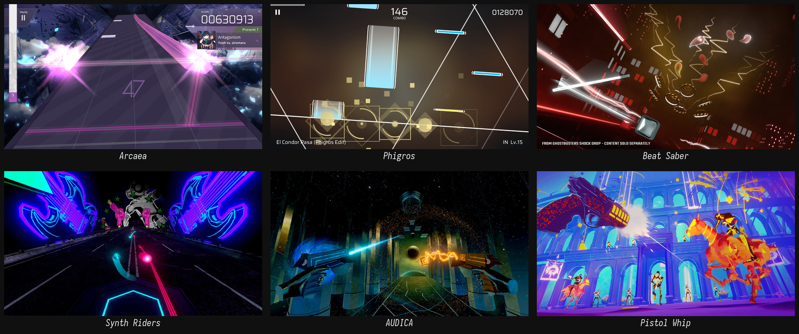

# Parallax — 视觉参考库

> 建立：2026-10-17 ｜ 服务阶段：Phase 0 审美风格
> 目的不是收集好看的图，而是把 4.1「被剖开的精密仪器」拆成**可以逐条核对的空间规则**。



## 一句话结论

这六款游戏里，**没有一款解决 Parallax 的核心构图**——腰高 4 轨窗口（6 轨场）+ 头顶空域 + 整体横移。
它们能回答的是更基础的问题：**轨道怎么读、判定面放哪里、左右手怎么编码、HUD 放哪里、菜单怎么不变成网页**。
材质、体积、接触阴影仍然要 Parallax 自己解决；参考图只提供语法，不提供表面。

## 目录

```
references/
├── arcaea/                 13 张：2 张游玩 + 5 张键型近景 + 6 张界面
├── phigros/                 7 张：3 张游玩 + 4 张界面
├── vr-rhythm/              21 张：Beat Saber / Synth Riders / AUDICA / Pistol Whip
├── contact-sheets/          7 张拼版，用来快速扫
├── sources/manifest.csv    每张图的原始地址与尺寸（41 行）
├── 01-arcaea.md
├── 02-phigros.md
├── 03-vr-rhythm.md
└── 04-synthesis.md         ← 如果要只读一篇，读这篇
```

## 按问题查图

| 要回答的问题 | 先看 | 结论方向 |
| --- | --- | --- |
| 4 轨可视窗口（物理场 6 轨）在腰高怎么分得清 | `arcaea/gameplay/01`、`arcaea/gameplay/02`、`vr-rhythm/beat-saber/01` | 2D 靠收敛线；VR 靠槽的侧壁与遮挡 |
| 判定面能不能是浮线 | `phigros/gameplay/01`、`arcaea/gameplay/02` | 2D 可以；VR 不行，必须是材质状态，且常态不动 |
| arc 在 3D 里怎么读 | `vr-rhythm/synth-riders/01`、`03`、`05`、`arcaea/note-types/01` | 恒宽 + 亮前缘 + 外壁轮廓 |
| 左右手怎么编码 | `vr-rhythm/beat-saber/01`、`05`、`vr-rhythm/audica/01`、`arcaea/note-types/01` | 颜色最有效，但必须有冗余线索 |
| HUD 放哪 | `vr-rhythm/audica/05`、`vr-rhythm/synth-riders/04`、Beat Saber 全部 | 要么消失，要么成为世界里的物件 |
| 菜单怎么不变成网页 | `arcaea/ui/02`、`03`、`04`、`phigros/ui/01`、`02` | 用条带/斜切做信息分组，不用卡片网格 |
| 浅色模式的对比 | `arcaea/gameplay/02` | Arcaea 自己也没完全解决，可当反例 |
| 背景能不能动 | `vr-rhythm/synth-riders/01`、`03`、`vr-rhythm/audica/03` | 可以 3D / 动画 / shader，但必须在可打区之外、明度低于键 |
| 抽象但不失体积 | `vr-rhythm/pistol-whip/03` | 低多边形仍然有面、有影、有剪影 |

## 三条已经能确认的事

1. **Arcaea 的 4 轨是 2.5D 的纵深折叠，不是真高度。**
   它的 Floor Input 在屏幕下方（近），Sky Input 在屏幕中部（远）。Parallax 要把这层折叠重新展开成真实高度：腰 → 头顶。直接抄 Arcaea 的透视，会把「天空」做成「远处」。

2. **Phigros 证明了判定线可以动，但它的前提是「线是画面唯一高对比元素」。**
   Parallax 同时有金属高光、玻璃内光、釉面反光，判定线一旦也动，就会和材质抢对比；而且硬规则是**常态相对槽底不动**。判定必须降级为「槽底的一段亮带」，而不是又一根发光的线。

3. **VR 音游的 HUD 只有两种活法：消失，或者变成世界里的物体。**
   Beat Saber 几乎没有 HUD；AUDICA 把分数做成场景里的环；Synth Riders 把分数放在轨道尽头。Parallax 的 HUD 托架方向是对的，但要先决定它固定在**世界**还是**视野**。

## 硬性限制（不随参考改变）

- **判定线相对槽底常态不动**：固定在槽底；只有愚人节 / 搞笑谱面允许，且必须明确标记。
- **可打区没有障碍物**：没有墙 / 炸弹 / Noise Field；背景物件不得进入可打区。愚人节也不破例。
- **背景可以是 3D / 动画 / shader**：但必须在可打区之外，明度不超过键，运动不带动参考系。
- **手别锁定**：标了左 / 右的元素不允许换手；换手按断连处理。愚人节也不破例。
- **高度上限**：超过上限的 note 不生成；上限之上不放「看起来可打」的东西。愚人节也不破例。

详见 `parallax-idea.md` 第 5 节。

## 怎么用

- 先看 `contact-sheets/overview.jpg`，再进对应游戏的拼版。
- 读 `04-synthesis.md` 的「借 / 不借」表，避免把霓虹、晶体、二次元立绘一起搬过来。
- 材质只借「像」，不做写实复刻：要的是表面行为（吃光、碎裂、留痕），不是照片级还原。
- 每张图的原始地址在 `sources/manifest.csv`；截图版权归原发行商，仅作设计研究，不进入发行包。

## 没有解决的问题

- 腰高 4 轨可视窗口的构图：远轨靠淡出解决；近 / 中 / 远三档的可读性仍未实测。
- shift 的剩余问题：6 轨场 / 4 轨窗口、0–5 硬边界、不回卷已定；滑动动画时长与可读性仍未测试。
- 头顶高度上限的可见性：上限已确定要有，但具体数值与提示方式（淡出 / 横梁 / 边缘）未定。
- 材质参考：这批图全是霓虹/玻璃/低多边形，没有一张能回答「黑阳极铝 + 陶瓷 + 冰 + 光滑玻璃」在头显里长什么样。**这是下一批参考要补的。**
- 背景 3D 演出的预算：明度、深度、运动速度、shader 复杂度，如何在不抢键的前提下成立？

---

### 素材来源

- App Store 官方截图（Arcaea、Phigros）
- Google Play 官方截图（Phigros 宣传图）
- Steam 商店页官方截图（Beat Saber、Synth Riders、AUDICA、Pistol Whip）
- Fandom Wiki 游玩截图与键型近景（Arcaea、Phigros）

完整清单：`sources/manifest.csv`（含原始 URL 与像素尺寸）。
